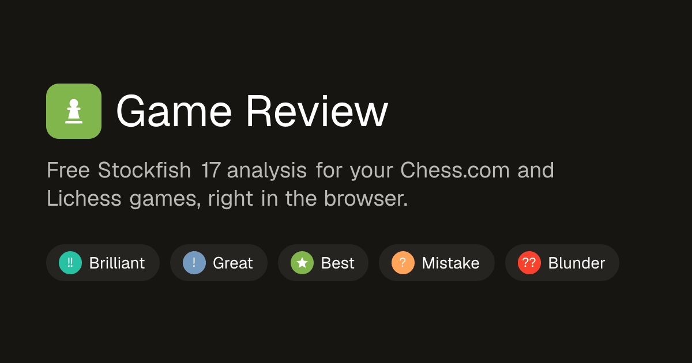
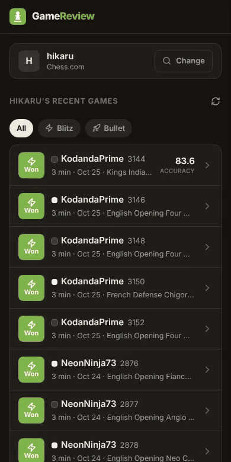
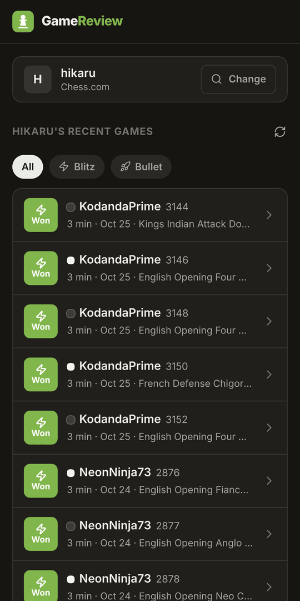
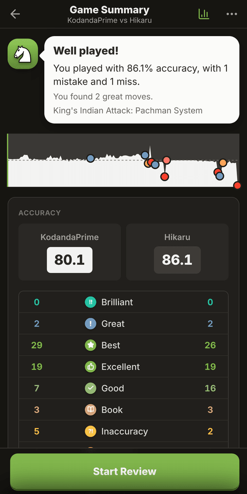
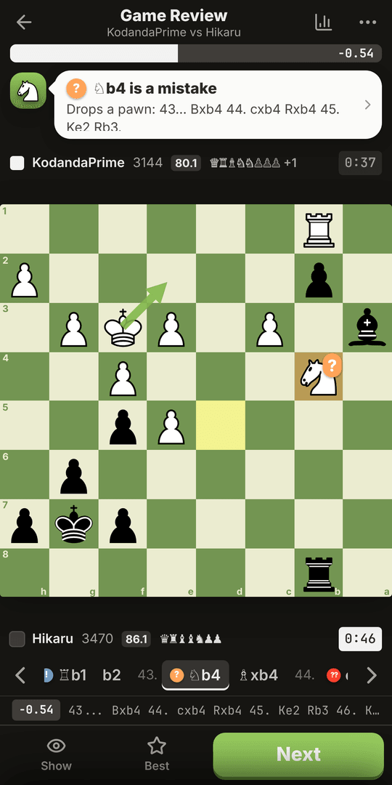
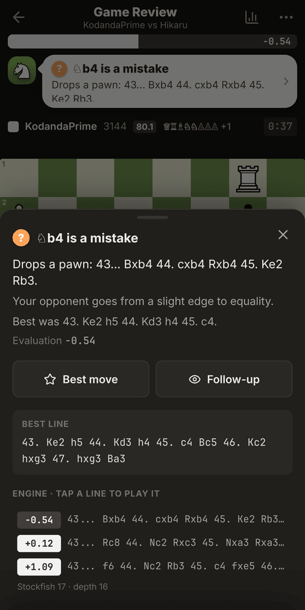
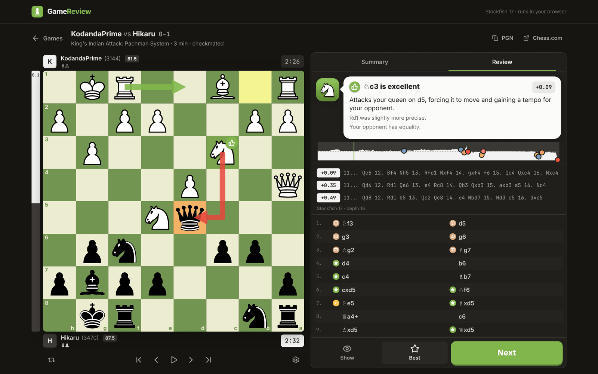

<div align="center">

<a href="https://chess-game-review.vercel.app"></a>

### Chess.com-style game review, free and private, with Stockfish 17 running in your browser.

[](https://chess-game-review.vercel.app)

[](https://github.com/ritstar/chess-game-review/actions/workflows/ci.yml)


[](LICENSE)

**[Try it](https://chess-game-review.vercel.app)** · [Features](#-features) · [How it works](#-how-the-analysis-works) · [Run locally](#-run-it-locally) · [Author](#-author)

</div>

---

Type your **Chess.com** or **Lichess** username, tap a game and get a full review in seconds: every move rated from Brilliant to Blunder, accuracy for both players, the key moments, and a coach that explains *why* in plain English. No account, no uploads and no limits, because the engine runs on your own device.

<div align="center">



<sub>Open a game → summary → step through the moves → a <b>Great</b> move pops → a mistake explained, with the best move shown</sub>

<br /><br />

| Pick a game | Summary | Review | Details |
|:---:|:---:|:---:|:---:|
|  |  |  |  |



</div>

## ✨ Features

<table>
<tr>
<td width="50%" valign="top">

### 🎯 Every move rated


Great and Brilliant moves get a Chess.com-style pop on the board, with a chime.

</td>
<td width="50%" valign="top">

### 🗣️ Explanations, not just symbols
> *"Allows a fork: Ne3 attacks your queen on d1 and rook on f1"*
> *"Missed mate in 2"* · *"Drops a pawn: 43… Bxb4 44. cxb4 Rxb4"*

Tactical checks on the engine lines find forks, hanging pieces, threats and material swings, and the coach tells you about them, along with the best line and the refutation.

</td>
</tr>
<tr>
<td valign="top">

### ♟️ Explore your own ideas
Drag a piece (or tap one and then a square) at any point. A live Stockfish rates the move you tried and explains it. **Back to game** returns you exactly where you left off. **Retry** lets you find a better move than your mistake, **Show** plays out the follow-up, and **Best** shows the engine's move.

</td>
<td valign="top">

### 📊 The whole game at a glance
Accuracy for both players (the Lichess method), an evaluation graph with key moments marked (tap or drag it to jump around), the top 3 engine lines, opening names from a 3,800-line book, clocks and captured material.

</td>
</tr>
<tr>
<td valign="top">

### 📱 Built for phones first
One full-screen view that never scrolls: eval bar, coach, a full-width board, a swipeable move strip and a thumb-reach action bar. Details open as bottom sheets. It's installable to the home screen as an app (PWA), and respects the notch and the home indicator.

</td>
<td valign="top">

### 🔊 Feels like a real board
Distinct sounds for moves, captures, checks, castling and promotion, all generated in code with no audio files. Haptics on Android, plus a light tap on recent iPhones. Five board themes (including wood), autoplay and keyboard shortcuts.

</td>
</tr>
<tr>
<td valign="top">

### ⚡ Fast
Positions are analysed in parallel by a pool of Stockfish WASM workers, so a 40-move game usually takes 10–30 seconds. Finished reviews are cached in IndexedDB, so reopening a game is instant.

</td>
<td valign="top">

### 🔒 Private
Everything runs in your browser. Your games go straight from the Chess.com / Lichess API to your device and nowhere else. You can share a link to any review: `?src=chesscom&u=<user>&g=<game>`.

</td>
</tr>
</table>

<details>
<summary><b>⌨️ Keyboard shortcuts</b></summary>

| Key | Action |
|---|---|
| <kbd>←</kbd> <kbd>→</kbd> | Previous / next move |
| <kbd>↑</kbd> <kbd>Home</kbd> · <kbd>↓</kbd> <kbd>End</kbd> | Start / end of the game |
| <kbd>Space</kbd> | Autoplay |
| <kbd>F</kbd> | Flip the board |
| <kbd>Esc</kbd> | Back to the game from an explored line |
| <kbd>Backspace</kbd> | Undo an explored move |

</details>

## 🧠 How the analysis works

| Step | What happens |
|---|---|
| **Engine** | Each position is searched once with MultiPV 3 (Standard: depth 16, capped at 1.5 s), spread across up to 4 single-threaded Stockfish 17.1 workers. |
| **Win %** | Scores become winning chances with the logistic model Lichess fitted on real games. |
| **Classification** | Based on **expected points lost** against the best move, using Chess.com's published bands: ≤2% Excellent, ≤5% Good, ≤10% Inaccuracy, ≤20% Mistake, >20% Blunder. A +0.5 → −1.0 swing is serious; +9 → +7.5 isn't. |
| **Best / Great** | **Best** is the engine's top move. **Great** is the top move when every alternative is at least a mistake. Plain recaptures don't count. |
| **Brilliant** | A sound **sacrifice**: it leaves material the opponent can win by static exchange (legal-move SEE, so pins and checks count), it is still (near-)best, and you weren't already completely winning. |
| **Miss** | You failed to punish your opponent's mistake or blunder. |
| **Book** | The position is in the [Lichess openings](https://github.com/lichess-org/chess-openings) dataset, including transpositions. |
| **Accuracy** | The Lichess method: per-move accuracy from win % lost, combined as a volatility-weighted mean and a harmonic mean. |

## 🚀 Run it locally

Requires **Node.js 20+**.

```bash
git clone https://github.com/ritstar/chess-game-review.git
cd chess-game-review
npm install
npm run dev        # → http://localhost:3000
```

| Script | |
|---|---|
| `npm run build` / `npm start` | Production build and server |
| `npm run check` | Lint, typecheck and tests |
| `npm test` | Unit tests plus an end-to-end test that runs the real Stockfish build in Node |
| `npm run build:openings [dir]` | Regenerate `public/data/openings.json` from the Lichess openings TSVs |

<details>
<summary><b>📁 Project layout</b></summary>

```
app/                Next.js app router entry, layout, metadata and global styles
components/
  App.tsx           Home screen, game search and routing between views
  home/             Game source picker and game list
  review/           Board, eval bar and graph, move list, coach, engine lines, summary
hooks/
  useGameReview.ts  Runs the engine pool, streams results and caches finished reviews
  useExplorer.ts    Live engine and ratings for moves tried on the board
lib/
  engine/           UCI parsing and the Stockfish worker pool
  analysis/         Classification, explanations, tactics (SEE, forks), accuracy, openings
  games/            Chess.com / Lichess API clients and PGN parsing
  review/           Board navigation state (game moves and explored lines)
  sound.ts, haptics.ts  Board feedback
public/stockfish/   Stockfish 17.1 lite, single-threaded WASM build
public/data/        Generated opening book
tests/              Vitest suites
```

</details>

<details>
<summary><b>☁️ Deployment</b></summary>

Live at **https://chess-game-review.vercel.app**. Every push to `main` deploys to Vercel, and CI runs lint, typecheck, tests and a production build.

The app is static apart from Next.js itself, so it runs anywhere Next.js does (Vercel, Netlify, a Node server). Security headers (CSP, frame and referrer policies) and cache headers for the engine binary are set in `next.config.ts`. The CSP allows outgoing requests only to `api.chess.com` and `lichess.org`. Set `NEXT_PUBLIC_SITE_URL` if you host it on another domain; it's used for canonical URLs, the sitemap and link previews.

</details>

## 👤 Author

<a href="https://github.com/ritstar"></a>

**[@ritstar](https://github.com/ritstar)**<br />
If this helped your chess, consider giving the repo a ⭐. Bugs and ideas are welcome in [issues](https://github.com/ritstar/chess-game-review/issues).

<br clear="left" />

## 📜 Licence

Copyright © 2026 [@ritstar](https://github.com/ritstar). Released under the **[GNU General Public License v3.0](LICENSE)** or (at your option) any later version, and distributed without any warranty. GPLv3 because the app ships Stockfish, which is GPLv3: anyone who distributes a modified version must share its source under the same licence.

### Credits

- [Stockfish](https://stockfishchess.org) and [stockfish.js](https://github.com/nmrugg/stockfish.js) (GPLv3)
- [chess.js](https://github.com/jhlywa/chess.js) (BSD-2-Clause) and [react-chessboard](https://github.com/Clariity/react-chessboard) (MIT)
- Opening data: [lichess-org/chess-openings](https://github.com/lichess-org/chess-openings) (CC0)

<div align="center"><sub>Not affiliated with Chess.com or Lichess.</sub></div>
